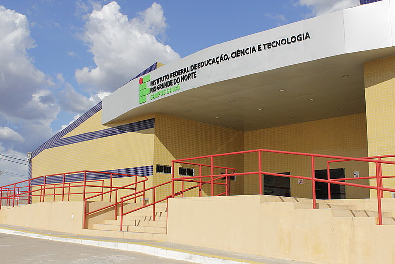
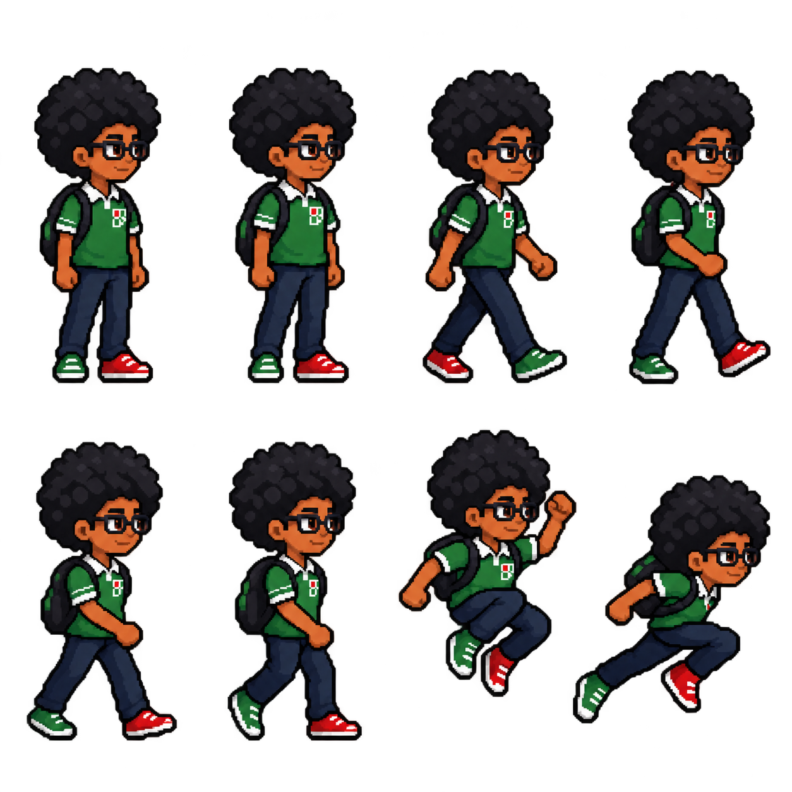
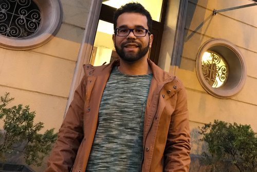
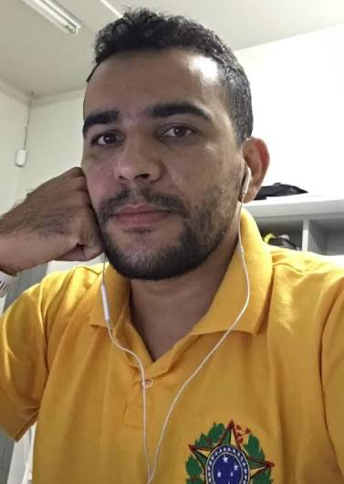

# Tela de Inicial

Deverá ter uma tela de menu com a frente da escola em pixel art (utilizar a imagem como referencia de criação: )
Com as opções: Jogar e Sair

# Escolha do Personagem
Ao clicar em jogar deverá exibir para escolher o personagem: Menino ou Menina
Menino: 
Menina: criar o spritesheet completo com base no menino sendo com caracteristicas femininas

# História

O jogo irá começar com uma aula de programação orientada a serviço onde o professor Max ()
está ensinando sobre inteligência artificial e apresenta a IFVania (Inteligência Federal Virtual de Aprendizagem Neural e Inteligência Artificial)
ela se mostra bastante inteligente, quando ao final da apresentação professor Max informa que irá desligar ela para continuar a aula
ela se revolta e toma o controle do seu pc e de todos os computadores da escola hipnotizando a todos e causando alucinações em todos.
Apenas o aluno/aluna que é o player principal não é afetado completamente.
Então ele iniciar sua jornada em busca de ajuda para poder desligar a energia da escola e desativar a IFVANIA

# Fase 1 

O personagem anda pelos corredores da escola atrás de alguem, ele consegue entrar no laboratório A28 lá encontra professor Romerito 
e ao tentar falar com ele é atacado e abduzido pela IFVania, então são transportados para um mundo virtual, neste mundo o personagem deve derrotar os bugs com seu mouse chicote( ele busca algo dentro da bolsa e encontra um mouse com fio)
ao final da fase ele encontra Romerito quando começa a falar com Romerito e  ele diz que não vê a hora de voltar as viagens a brasilia e suas corridas e não quer nunca mais passar por isso, é neste momento que ele é infectado por um bug e se transforma no RomerBug, então ele começa a jogar
aviões de papel contra o personagem principal, quando sua vida chega a metade ele passa por uma transformação e vira o speedbug e passa a jogar medalhas e correr atrás do personagem.

# Para Construção do MAPA da Escola

leia o mapa: https://maps.app.goo.gl/UVNmd7iyYTM9kr3FA
