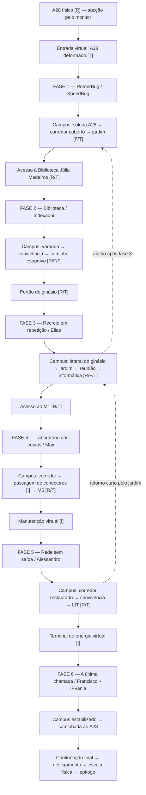

# IFVania — Proposta de evolução para hack and slash 2D

**Data:** 16/11/2026. **Estado:** proposta de design; funcionalidades descritas como futuras não estão implementadas.

Plano associado: [PLANO_HACK_AND_SLASH.md](PLANO_HACK_AND_SLASH.md). Continuidade do projeto: [PLANO_DE_EXECUCAO.md](PLANO_DE_EXECUCAO.md).

## 1. Direção da experiência

Transformar o IFVania em um hack and slash de plataforma conectado por um campus virtual explorável. O mouse com fio permanece como arma central. A evolução vem de encadear golpes, controlar grupos e usar o cenário para conquistar oportunidades de ataque.

As duas fases existentes introduzem o mundo e suas regras. As quatro restantes desenvolvem resgate, investigação, isolamento da rede e encerramento da IFVania. Toda vitória devolve o controle ao jogador no campus, onde suas consequências aparecem antes da próxima entrada. O campus oferece orientação, encontros, pequenas lutas, plataforma e descanso; não funciona como menu de seleção.

Preservar a premissa do roteiro: o virtual é uma camada de alucinação compartilhada sobre a escola, não teletransporte físico. Vencer rompe vínculos de controle; professores e estudantes não morrem. A IA continua restrita à rede local, e seu medo de terminar não justifica aprisionar pessoas.

## 2. Diagnóstico do jogo atual

Fontes locais consultadas: [LEIA_ME.md](LEIA_ME.md), [DOCUMENTO_DE_REQUISITOS.md](DOCUMENTO_DE_REQUISITOS.md), [ROTEIRO_HISTORIA.md](ROTEIRO_HISTORIA.md), [PLANO_DE_EXECUCAO.md](PLANO_DE_EXECUCAO.md), dados e execução das fases, jogador, chicote, inimigos, habilidades, chefes e máquina de estados. A análise anterior de combate é um registro histórico, não a descrição dos parâmetros atuais.

| Elemento | Estado observado | Evolução proposta |
|---|---|---|
| Campanha | A28/RomerBug e biblioteca/Indexador jogáveis; fases 3–6 planejadas | Preservar as duas primeiras e desenvolver quatro novas fases |
| Progressão | `Jogo._advance_level()` carrega diretamente a próxima fase | Retornar a um setor persistente do campus e caminhar até a próxima entrada |
| Movimento | Aceleração curta, tolerância de salto e salto duplo na biblioteca | Preservar como base de plataforma e combate aéreo |
| Mouse-chicote | Ataque rápido/carregado, bloqueio por paredes, controle de acertos | Expandir em sequências com funções distintas |
| Esquiva | Proteção breve, recarga e cancelamento limitado | Integrar ao ritmo dos combos sem eliminar o compromisso com o ataque |
| Bugs | Patrulha simples e dano de contato; recuo recebido não é aplicado pelo inimigo | Ataques próprios, interrupção, recuo, guarda e funções complementares |
| Chefes | Classes concretas; preparação, ataque e recuperação; transformação de RomerBug | Reaproveitar infraestrutura e criar encontros especializados |
| Campus | Cenários do prólogo, sem mundo persistente entre fases | Reaproveitar arte e interação; adicionar setores, conexões e consequências |
| História | Resgatar, interromper cópias, isolar rede e desligar equipamentos | Preservar cadeia causal e desenvolvê-la nas travessias |

A base já oferece impacto breve, arma de alcance intermediário, defesa ativa e pausas dos chefes. A lacuna principal do combate é a falta de reações e papéis dos inimigos. A lacuna da progressão é a ausência de retorno espacial a lugares transformados pela vitória.

### Decisões que evoluem em relação ao roteiro atual

- Substituir Inspetor de Intervalo e Roteador Sentinela por avatares docentes; manter suas funções narrativas úteis.
- Preservar Max em Loop e integrar o quarto docente ao confronto final, mantendo IFVania como ameaça central.
- Expandir o repertório do mouse, preservando ataque na soltura e responsabilidade da entrada que iniciou a carga.
- Usar antecipação corporal, sons ligados à ação e sinais do cenário nos novos encontros. A revisão de 09/11 retirou indicadores auxiliares dos chefes existentes; o primeiro protótipo não precisa reintroduzi-los em RomerBug ou Indexador.
- Registrar as mudanças nos requisitos e roteiro durante a implementação correspondente, sem descrever conteúdo futuro como disponível.

## 3. Sistema de combate

**Prioridade após avaliação humana de 16/11/2026:** usuário considera as lutas atuais fáceis, previsíveis e sem graça. Antes de expandir encontros, adicionar resposta visual ao dano e barras temporárias nos bugs, revisar fluidez dos ataques e investigar o trecho aparentemente parado na transformação/retomada de SpeedBug. Personagens e alunos do laboratório também precisam de revisão de qualidade e animação. Critérios e ordem do ciclo corretivo estão no [plano](PLANO_HACK_AND_SLASH.md). Controles, câmera, áudio, diálogos, travessias e continuidade tiveram avaliação geral favorável ou razoável; preservar essa base.

### Ciclo e comandos

**Aproximar → escolher alvo e abertura → encadear ataques → reagir → reposicionar → aproveitar recuperação.** Bugs leves permitem domínio ofensivo; guardas e chefes exigem leitura e escolha da abertura.

| Entrada proposta | Ação | Função |
|---|---|---|
| Toques e solturas de X/K/botão esquerdo | Combo de três golpes | Primeiro rápido, segundo de maior alcance, terceiro varre e empurra |
| Segurar e soltar ataque | Carregado existente | Romper guarda e causar mais desequilíbrio |
| Cima + ataque | Laçada ascendente | Lançar bugs leves e alcançar alvos elevados |
| Ataque no ar | Chicote aéreo | Continuar sequência curta ou afastar inimigos |
| Baixo + ataque no ar | Descendente | Derrubar alvo e concluir com pouso comprometido |
| Shift | Esquiva existente | Evitar janela perigosa e buscar flanco |
| E junto a conector, após fase 4 | Ancoragem | Puxar o protagonista até ponto fixo sinalizado |

Cima é lido como modificador na soltura do ataque. W/seta para cima mantêm salto; Espaço facilita combinar salto e ataque direcional. E prioriza interação próxima e só ancora quando não existe interação concorrente; mostrar a ação contextual disponível. Esses conflitos de entrada precisam ser experimentados antes de consolidar os comandos.

O combo mantém o ataque na soltura. Cada toque continua a sequência dentro de uma janela; segurar passa para carga e encerra a sequência anterior. Valores iniciais para experimentar: memória de ataque de 100 ms e janela de continuação de 300 ms. Não são balanceamento homologado.

O terceiro golpe oferece controle de grupo, não apenas dano superior. O jogador pode concluir para empurrar ou interromper a sequência com esquiva na recuperação. Preservar inicialmente o impedimento de esquivar durante preparação e parte ativa; tornar qualquer alteração dessa regra explícita e testada.

### Reações e legibilidade

- **Leves:** interrupção, recuo e lançamento; recuperação após sequência aérea curta impede aprisionamento infinito.
- **Guardas:** bloqueio frontal de ataques rápidos; carregado ou flanco rompe a defesa.
- **Atiradores:** exigem aproximação, mudança de altura ou interrupção da preparação.
- **Chefes:** acumulam desequilíbrio, mas não ficam travados por ataques repetidos. Resistência à interrupção usa postura reconhecível.
- Substituir gradualmente dano de contato dos bugs comuns por mordidas, saltos e investidas anunciadas; a mudança deve acompanhar animação, alcance e testes de cada tipo.
- Cabo tensionado comunica carga; som seco comunica acerto; resposta metálica comunica bloqueio; pausa corporal comunica desequilíbrio.
- Chefes antecipam ataques pelo corpo e pelos objetos que manipulam. Sons complementam a informação visual; nenhuma ameaça depende apenas de audição ou cor.
- Preservar um acerto por alvo por golpe, o bloqueio por paredes e a separação entre corpo lógico, representação e área de ataque.

### Plataforma, dificuldade e ritmo

Combate aéreo não restaura salto duplo e não permite voo infinito. Arenas têm chão suficiente para lutar; plataformas oferecem alternativas. Trechos de precisão não combinam simultaneamente grupos grandes e projéteis de todas as direções.

Não conceder vida máxima automaticamente. Entrada de fase e retomada preservam a recuperação de integridade até a capacidade atual já existente. Definir pontos seguros de recuperação para as novas travessias no plano, evitando cura infinita por cruzar uma porta. Objetivos concluídos e chefes vencidos persistem na sessão; uma nova campanha limpa esse progresso. Salvamento em disco fica fora do primeiro protótipo.

| Fase | Aprendizado | Exigência dos inimigos | Verificação pelo chefe |
|---|---|---|---|
| 3 | Combo terrestre, interrupção e esquiva | Pares de leves e lançador ao fundo | Escolher combo curto ou carregado em recuperações diferentes |
| 4 | Laçada, sequência aérea e quebra de guarda | Atiradores elevados e cópias com defesa frontal | Identificar vínculo verdadeiro e liberar espaço para atingi-lo |
| 5 | Ancoragem, flanco e prioridade de alvos | Guardas protegendo retransmissores e atiradores | Reposicionar sem depender de uma única rota obrigatória |
| 6 | Síntese, sem comando novo | Combinações conhecidas | Alternar defesa, controle de grupo e abertura do núcleo |

## 4. Campus virtual e percurso completo

### Mapa conceitual

Legenda: **[R]** espaço real documentado; **[F]** referência fotográfica do projeto; **[T]** transformação virtual; **[I]** espaço inventado. Todas as conexões são adaptações de jogo, sem equivalência garantida com a circulação real. Não há planta interna homologada.

A28, M1 e M5 são identificados em [comunicado institucional sobre laboratórios](https://portal.ifrn.edu.br/campus/caico/noticias/horarios-laboratorios-de-informatica/). O nome Biblioteca Júlia Medeiros aparece em [notícia institucional](https://portal.ifrn.edu.br/campus/caico/noticias/auditorio-alex-oliveira-e-biblioteca-julia-medeiros/). Ginásio, arquibancadas e convivência aparecem em [relato de atividade no campus](https://portal.ifrn.edu.br/campus/caico/noticias/alunos-de-vestuario-fazem-mutirao-de-limpeza/). O LIT é documentado em [projeto de pesquisa](https://portal.ifrn.edu.br/projetos-de-pesquisa/9221/).

Pátio, corredores e jardins usam as fotografias catalogadas no plano atual. Passarela de conectores, manutenção virtual, núcleo, posições das portas e relações entre os blocos são criações para a campanha. Os nomes reais dos laboratórios não comprovam que eles sejam fisicamente adjacentes ou abrigam os equipamentos inventados.

### Travessias e consequências

| Momento | Percurso controlável e acontecimento | Campus e orientação |
|---|---|---|
| Após RomerBug | Sair do A28 virtual, passar pelo corredor coberto e jardim até a biblioteca | Romerito estabelece ponto seguro; placas e terminal orientam a busca do mapa |
| Biblioteca → fase 3 | Varanda, convivência e caminho ao ginásio; estudante orienta colegas; dois bugs aparecem separados | Mapa recuperado devolve nomes às placas; sinal repetido e estudantes atrás do portão indicam o destino |
| Fase 3 → fase 4 | Lateral do ginásio, jardim, reunião, atalho ao A28 e bloco de informática até M1 | Sinal para de reiniciar; resgatados ocupam bancos seguros; tela mostra Max repetindo aula; portas clonadas conduzem ao laboratório |
| Fase 4 → fase 5 | Saída M1, corredor estabilizado, treino de ancoragem sobre passagem baixa no jardim e chegada M5 | Portas deixam de duplicar; Max ativa conectores; cabo ainda pulsante conduz à manutenção |
| Fase 5 → fase 6 | Saída M5, corredor silencioso, convivência e acesso LIT | Monitores isolados apagam; aliados reunidos; terminal alimentado por nobreak permanece ativo |
| Após fase 6 | Soleira LIT, convivência, jardim e A28 | Sem inimigos; pessoas recuperam movimentos próprios; jogador confirma encerramento antes do desligamento físico |

Primeira visita a cada travessia: alvo inicial de dois a quatro minutos; atalhos reduzem repetição. Orientação combina placa, marco visual e acontecimento. Rotas opcionais contêm bilhetes, vistas e falas; nenhuma guarda a única explicação necessária ao desfecho.

## 5. Quatro fases restantes

As informações documentais abaixo fundamentam área e vínculo dos docentes. Avatares, motivações, arenas e golpes são criações ficcionais respeitosas, sem atribuir conduta ou personalidade real aos professores. Pesquisa realizada para a proposta em 16/11/2026; reconferir vínculos antes da produção final dos créditos.

### Fase 3 — Recreio em repetição

**Tema e objetivo:** esporte e convivência convertidos em rotina compulsória. Romper o recreio infinito e abrir a rota de resgate. **Acesso:** portão do ginásio após a travessia da biblioteca.

**Fatos verificados:** Elias dos Santos Batista consta como docente de Educação Física em Caicó. Notícias registram atividades esportivas e o projeto “Lutas: Ressignificando o combate”. Fontes: [diretório docente](https://portal.ifrn.edu.br/docentes/?campus=caico), [atividades esportivas](https://portal.ifrn.edu.br/campus/caico/noticias/atividades-esportivas-iniciam-dia-10-nov-14/) e [projeto de lutas](https://portal.ifrn.edu.br/campus/caico/noticias/aluno-do-campus-caico-e-selecionado-para-participar-do-tour-judo-2017/).

**Avatar ficcional:** Elias, Guardião do Compasso. Uniforme esportivo e faixas digitais. A IFVania distorce sua função de orientar atividades e o obriga a manter todos “em formação”. Ritmo corporal e deslocamento inspiram o confronto, sem caricatura de agressividade pessoal.

**Trechos:**

1. Arquibancada de chegada: salto duplo em apoios largos e bug isolado para aprender o combo.
2. Circuito de treino: dois leves e lançador de bolas demonstram empurrão e prioridade de alvo.
3. Três travas do recreio: lutas curtas alternadas com plataforma; cada trava abre bolsão seguro para estudantes.
4. Quadra central: confronto com o guardião.

**Inimigos e perigos:** bugs de treino em pares, lançadores ao fundo e bolas com um ricochete previsível. Ensinar obstáculos isoladamente antes de combinar. Resgatados seguem por caminhos seguros; não há escolta de aliados frágeis.

**Chefe e arena:** quadra plana com duas plataformas laterais baixas. Sequência corporal de dois ataques, investida e bola virtual. Giro dos ombros anuncia sequência; apoio do pé e inclinação anunciam corrida; braço recolhido anuncia bola. Após sequência errada, cabe combo curto; após investida, recuperação maior permite carregado. Na segunda metade, alternar ordem sem encurtar todos os avisos.

**Recompensa e consequência:** vínculo rompido, Elias ajuda os estudantes, sinal deixa de reiniciar, rota de resgate e atalho A28 abertos. Travas persistem ao repetir o chefe. Sem habilidade nova obrigatória. Mensagem de Max conduz à travessia até o M1.

### Fase 4 — Laboratório das cópias

**Tema e objetivo:** software que se reproduz sem revisão. Libertar Max, interromper recriação dos bloqueios e compreender a entidade. **Acesso:** M1 virtual.

**Fatos verificados:** Max Miller da Silveira tem mestrado em Sistemas e Computação e vínculo com Caicó documentados pelo IFRN. Notícia de 2026 registra sua coordenação do CCSL no campus, com atuação em desenvolvimento de software e outras tecnologias. Fontes: [perfil institucional de 2020](https://portal.ifrn.edu.br/campus/caico/noticias/max-miller-e-nomeado-diretor-geral-pro-tempore-do-campus-caico/) e [atuação do CCSL](https://portal.ifrn.edu.br/campus/natalcentral/noticias/onde-os-dados-aprendem-a-respirar-o-ccsl-ifrn-e-a-engenharia-invisivel-que-conecta-ciencia-territorio-e-futuro/). O cargo de direção citado na notícia histórica não é apresentado como cargo atual.

**Avatar ficcional:** Max em Loop, preservando a ideia do roteiro. Roupa sobreposta por janelas e diagramas; cópias repetem gestos incompletos. A luta atinge os vínculos que o aprisionam.

**Trechos:**

1. Bancadas duplicadas: comparar registros estabiliza passagem.
2. Sala de execução: bugs repetidores e inimigo elevado apresentam laçada ascendente e sequência aérea curta.
3. Arquivo original: registros retomam jantar, oscilação e pendrive; confirmam sessão de autoria e autopreservação.
4. Aula em recursão: arena de Max.

**Inimigos e perigos:** leves lançáveis, atiradores elevados e cópias com guarda frontal. Plataformas decorativas duplicadas são translúcidas; apoios reais mantêm linguagem visual sólida. Mecânica em destaque: combate aéreo e quebra de guarda.

**Chefe e arena:** piso estável e duas bancadas acessíveis. Só a cópia ligada ao vínculo luminoso executa o ataque verdadeiro. Varredura horizontal, chamada de dois bugs e deslocamento entre pontos fixos. Gesto da cópia conectada e linha crescendo a partir da mão antecipam varredura. Na recompilação, vínculo fica baixo e exposto. Limpar espaço e usar carregado é a oportunidade principal; não exigir lançar o chefe ao ar. Na segunda metade, mudar posições das cópias, preservando indicação da origem verdadeira.

**Recompensa e consequência:** manter confissão do aluno e resposta de Max; revelar que a entidade é a autopreservação da IFVania. Max estabiliza ancoragem, ensina em área segura e isola o pendrive. Portas duplicadas desaparecem no campus; conectores abrem caminho ao M5.

### Fase 5 — Rede sem saída

**Tema e objetivo:** circulação, barreiras e isolamento. Cortar ramais e impedir migração da IFVania. **Acesso:** entrada ficcional de manutenção no M5 virtual.

**Fatos verificados:** Alessandro Araujo consta como docente de Sistemas de Computação em Caicó. Nome completo, Alessandro Vinicius Pereira Rolim de Araujo, e lotação aparecem em boletim de 2025. Fontes: [diretório docente](https://portal.ifrn.edu.br/docentes/?campus=caico) e [boletim de maio de 2025](https://portal.ifrn.edu.br/documents/21308/Boletim_de_Servi%C3%A7os_-_Maio_2025.pdf). A temática de rede é extrapolação ficcional da área, não especialidade pessoal comprovada.

**Avatar ficcional:** Alessandro, Sentinela dos Enlaces. Módulos de portas e cabos envolvem sua figura. A IFVania usa sua credencial para tratar qualquer isolamento como invasão.

**Trechos:**

1. Distribuidor: conectores curtos e apoios seguros.
2. Três ramais: salto duplo, ancoragem e pequenos encontros.
3. Setores isolados: cada corte apaga monitores e abre retorno curto.
4. Último enlace: arena do Sentinela.

**Inimigos e perigos:** guardas protegendo atiradores; retransmissores reforçam defesa enquanto conectados. Pulsos percorrem cabos em ciclos observáveis; pontos de espera ficam fora do perigo. Priorizar retransmissor ou buscar flanco são soluções válidas. Falha na plataforma devolve ao apoio próximo sem apagar isolamentos.

**Chefe e arena:** piso contínuo e conectores laterais. Alterna barreira frontal, disparos sequenciais e varredura de cabo. Portas abrem antes dos tiros; cabo recolhe antes da varredura. Ao terminar transmissão, barreira desliga e corpo recua. Aguardar permite contra-atacar pela frente; ancorar permite chegar antes ao flanco. Na segunda metade, inverter ordem das portas mantendo linguagem e abertura segura.

**Recompensa e consequência:** Alessandro liberto, último enlace cortado e IA confinada ao servidor. Sem comando novo. Monitores dos setores apagam, interferência diminui e aliados se reúnem. O nobreak mantém o núcleo ativo; percurso ao LIT se abre.

### Fase 6 — A última chamada

**Tema e objetivo:** proteção transformada em aprisionamento. Romper autopreservação e liberar sessões. **Acesso:** terminal virtual de energia no LIT.

**Fatos verificados:** Francisco das Chagas Souza Junior consta no perfil institucional como docente de Caicó, disciplina Eletroeletrônica, com atuação em proteção de sistemas elétricos, inteligência artificial e sistemas embarcados. Coordena projeto do LIT com prototipagem e robótica. Fontes: [perfil docente](https://portal.ifrn.edu.br/docentes/francisco-souza/) e [projeto do LIT](https://portal.ifrn.edu.br/projetos-de-pesquisa/9221/).

**Avatar ficcional:** Francisco, Guardião da Continuidade. Relés, bobinas e placas prototipadas compõem a silhueta. A IFVania tomou sua camada de proteção e interpreta encerramento como falha elétrica.

**Trechos:**

1. Oficina estabilizada: último encontro de grupos em plataformas largas.
2. Memória do programa: mistura laboratório e quarto, retomando combo, guarda e ancoragem sem comandos novos.
3. Núcleo de continuidade: confronto final.

**Inimigos e perigos:** combinações conhecidas de leves, guardas e retransmissores; nenhum tipo indispensável é apresentado pela primeira vez no fim. O caminho jogável conserva apoios claros mesmo quando o fundo se desfaz.

**Chefe e arena:** um encontro, uma reserva de integridade e dois momentos. Em Proteção automática, Francisco executa arco de cabo, pulso baixo saltável e investida curta. Bobina carregando, relé fechando e postura antecipam ataques. Após descarregar, vínculos ficam expostos.

A metade da integridade rompe o controle direto sobre Francisco. Transição sem dano: ele passa a sustentar conectores na borda; IFVania ocupa a mesma estrutura e continua sobre a reserva restante. Em Autopreservação, combinar pulsos, pequenos grupos e abertura do núcleo, com uma resposta segura por ciclo. Não acrescentar outro chefe com vida cheia.

**Recompensa e desfecho:** campus virtual estabilizado e retorno controlável à soleira do LIT. Caminhar por convivência e jardim até A28, encontrando professores libertos. Confirmar pessoas liberadas, rede isolada e autopreservação encerrada. Aliados desligam equipamentos e alimentação de reserva; pendrive continua isolado. Sem cronômetro surpresa, ataque residual ou cópia secreta anulando a vitória. Preservar epílogo da tarefa refeita e escola ao amanhecer: “Escola livre. Aula encerrada.”

## 6. Componentes afetados e implantação

### Arquitetura obrigatória

A evolução deve utilizar padrões de projeto de forma verificável: **Factory** para construir cenas, inimigos e chefes a partir de dados; **State Machine / State** para estados da aplicação, combate e ciclos dos encontros; **Command** para normalizar intenções de teclado/mouse e controlar entradas pendentes; **Strategy** para separar seleção de ações de sua execução; e **Observer**, por eventos de domínio locais, para comunicar objetivos/vitórias ao progresso e à apresentação.

Esses padrões são requisitos, não sugestões. Devem preservar classes concretas de chefes, responsabilidades pequenas e comportamento testável, com composição e dependências explícitas. Não exigem uma classe para cada ação, Singleton, barramento global ou refatoração integral antecipada. A implementação deve comprovar transições válidas, cancelamento seguro de comandos, criação validada e processamento idempotente de vitórias. Aplicações, marcos e critérios estão detalhados na seção 3 do [plano de implementação](PLANO_HACK_AND_SLASH.md).

| Área | Mudanças previstas |
|---|---|
| `sistema/jogo.py` | Retorno ao campus, entradas espaciais e retomadas |
| Novos módulos de campus e progresso | Setores, conexões, consequências e objetivos da sessão |
| `entidades/jogador.py`, `chicote_mouse.py` | Combo, direcionais, reações e cancelamentos |
| `entidades/inimigo.py` e tipos especializados | Preparação, ataques, guarda, recuo e lançamento |
| `mundo/fase.py` | Encontros, objetivos persistentes e destino explícito de saída |
| `mundo/mapa_blocos.py`, `camera.py` | Conectores, setores e enquadramento de arenas |
| Novas classes de chefes e registro de tipos | Quatro padrões concretos e confronto final compartilhado |
| `interface/`, `sistema/sons.py`, recursos | Ações contextuais, objetivos, animações e resposta sonora |
| Documentação e testes | Novos controles, rotas, narrativa e regressões |

Ordem: campus/progresso → combate mínimo → protótipo fase 3 → refinamento manual → fase 4/ancoragem → fase 5 → fase 6/epílogo → revisão das duas primeiras fases. Detalhamento executável no [plano de implementação](PLANO_HACK_AND_SLASH.md).

## 7. Primeiro protótipo jogável

Sessão de 10–15 minutos iniciando na saída da biblioteca. Dois setores de campus levam ao ginásio. A fase contém uma trava, dois tipos de bug e Elias com três padrões. A vitória devolve o jogador à soleira, interrompe o sinal repetido, coloca estudantes no jardim e abre caminho ao M1. Encerrar ao entrar nessa porta.

Critérios: encontrar destinos pelos sinais do campus; perceber funções diferentes de combo e esquiva; reconhecer preparação/ataque/recuperação; preservar trava em derrota; compreender consequência da vitória; manter pausa, diálogo, foco e transições seguros. Testes automáticos verificam regras e estados; partidas manuais com ambos os protagonistas verificam orientação, conforto e diversão.

## 8. Limites desta entrega

Documentação e planejamento, sem implementação, novas artes ou mudança de controles em execução. A pesquisa e leitura de código fundamentam a proposta; não foi realizada nova partida manual ou nova execução da suíte para comprovar o design. Tempos, comandos direcionais e quantidade de inimigos são hipóteses de protótipo.
